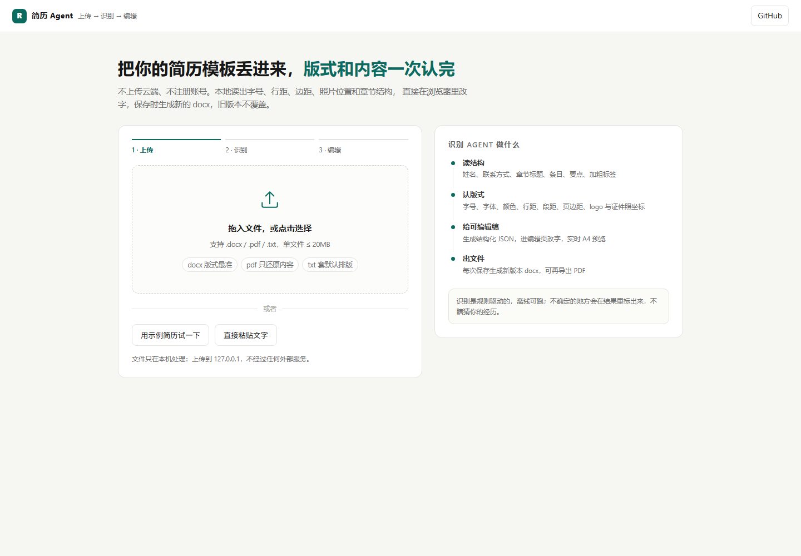
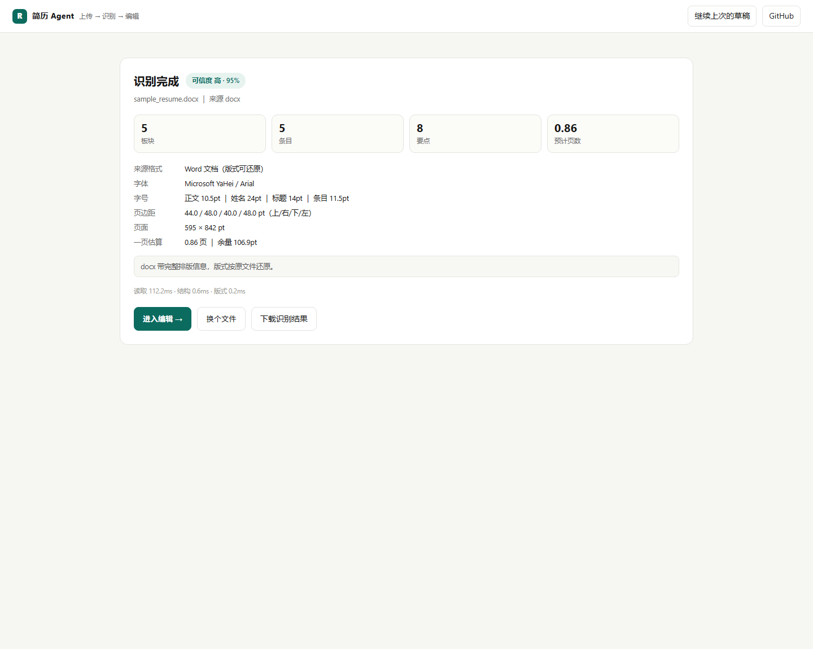
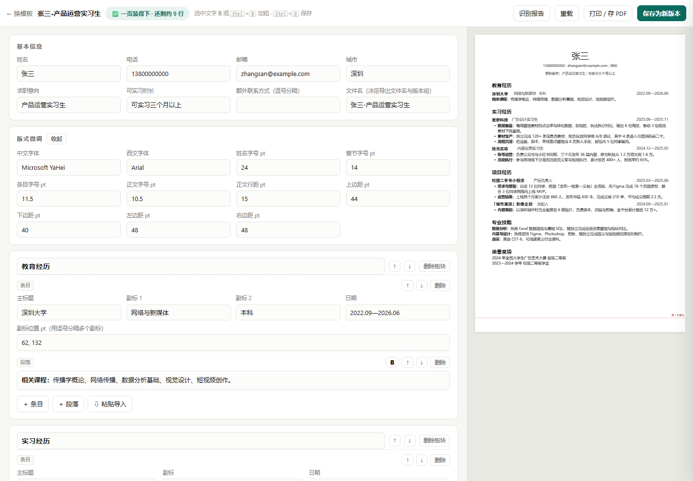
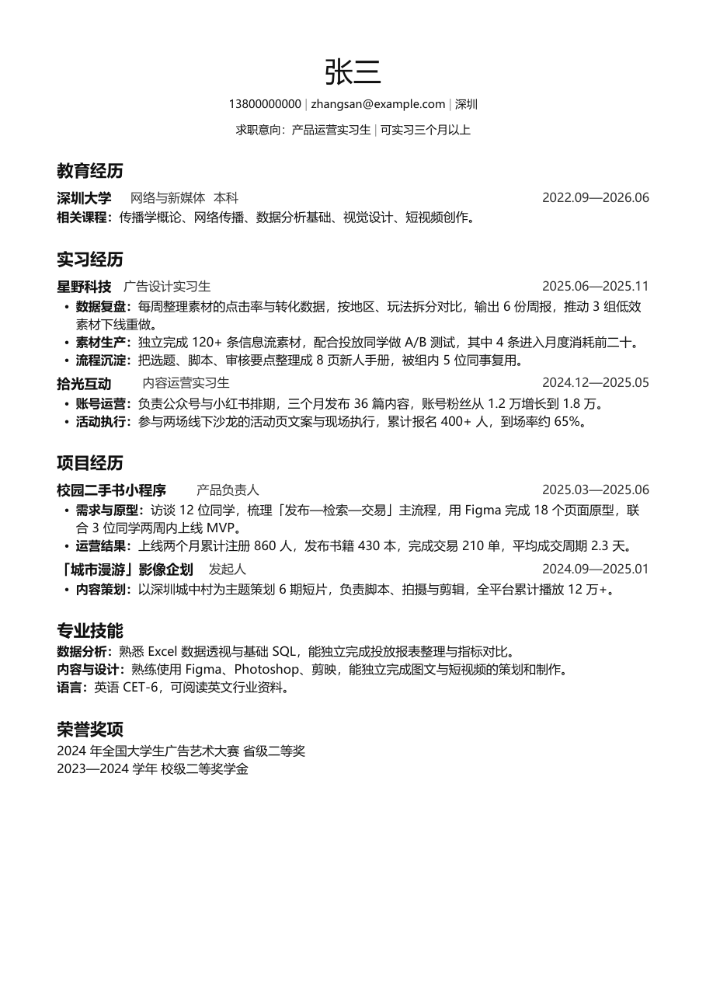

# 简历 Agent · resume-agent

> 上传简历或模板 → 自动识别版式与结构 → 浏览器里改字 → 生成新的 docx。
> 本地运行，不联网、不注册、不上传云端。



## 为什么做这个

海投的时候，改简历是个死循环：对着 JD 改内容 → 重新排版 → 导出 → 发现超了一页 → 再删再排。
内容每次都在变，排版每次都要重来；模板越好看，重排越痛苦。

这个工具把「排版」从每次重做，变成一次识别：

- 你给它一份**已经排好版的简历或模板**（.docx 最好）；
- 它把字号、行距、边距、颜色、照片位置、章节层级读出来，存成 `theme.json`；
- 再把内容拆成「章节 / 条目 / 要点 / 段落」，存成 `content.json`；
- 你在浏览器里改字，右边是同一套版式的 A4 实时预览；
- 保存时按 `theme.json` 重新生成 docx，版本号自增，不覆盖旧文件。

换一份 JD 只需要改内容，版式不用碰。

## 三步链路



1. **上传**：拖入 .docx / .pdf / .txt，或直接粘贴文字；
2. **识别**：Agent 读出结构与版式，给出可信度、页数估算和不确定的地方；
3. **编辑**：进入编辑页，左边改、右边实时预览；保存出 docx，打印可存 PDF。



## 识别到什么

| 类别 | 识别内容 | docx | pdf | txt |
| --- | --- | :--: | :--: | :--: |
| 结构 | 姓名、电话、邮箱、城市、求职意向、可实习时长 | ✅ | ✅ | ✅ |
| 结构 | 章节标题（教育 / 实习 / 项目 / 技能 / 荣誉…）与顺序 | ✅ | ✅ | ✅ |
| 结构 | 条目：标题、副标（可多列）、日期 | ✅ | ✅ | ✅ |
| 结构 | 要点、小字行、段落、加粗标签 | ✅ | ✅ | ✅ |
| 版式 | 中文字体、西文字体 | ✅ | ✅ | 默认 |
| 版式 | 姓名字号、章节字号、条目字号、正文字号 | ✅ | ✅ | 默认 |
| 版式 | 页边距、纸张尺寸 | ✅ | ✅ | 默认 |
| 版式 | 固定行距、章节/条目段前距、项目符号缩进 | ✅ | 估算 | 默认 |
| 版式 | 文字颜色、分隔线灰色 | ✅ | ✅ | 默认 |
| 版式 | 浮动 logo、证件照的页面坐标与尺寸 | ✅ | ✅ | — |
| 版式 | 占位符（【姓名】、{{电话}}）→ 留空待填 | ✅ | ✅ | ✅ |

> docx 带完整排版信息，还原度最高；PDF 只有文字坐标，行距和段距是估算的；
> 纯文本套默认「海投蓝本」版式，可在编辑页微调。双栏/侧栏模板会被拉平成单栏，并在报告里提示。

## 快速开始

需要 Python 3.9+。

```bash
git clone https://github.com/hexiaobing034-lang/resume-agent.git
cd resume-agent

python -m pip install -r requirements.txt
# 想读 PDF 再加一步：
# python -m pip install pymupdf

python app.py
```

浏览器会自动打开 <http://127.0.0.1:8765>。上传页点「用示例简历试一下」可以直接看效果；
`examples/blank_template.docx` 是一份只有占位符的空白模板，适合试「上传模板」的流程。

不想自动开浏览器：

```bash
python app.py serve --no-browser
```

## 日常工作流

1. 上传一份你已经满意的简历（比如上一版海投稿）；
2. 进编辑页，把内容改成这次 JD 要的版本；
3. 顶栏看「一页装得下 / 超出一页」徽标，超了就删低价值要点，或把正文行距调小 0.5pt；
4. 点「保存为新版本」，下载 `<文件名>_v3.docx`；
5. 需要 PDF 就点「打印 / 存 PDF」，在打印对话框里选「另存为 PDF」、纸张 A4、边距「无」。

旧版本不会被覆盖：每次保存都在 `workspace/versions/` 下新增 `_vN.docx` 和同名 JSON 快照。



## 命令行

```bash
# 解析一份简历，输出 content.json / theme.json / report.json
python app.py parse examples/sample_resume.docx -o workspace/parse

# 按内容和版式生成 docx
python app.py build workspace/parse/content.json out.docx --theme workspace/parse/theme.json

# 起服务（默认端口 8765）
python app.py serve --port 8765
```

`parse` 的终端输出会直接告诉你：来源格式、可信度、板块/条目/要点数量、字号、边距、估算页数。
示例：

```text
识别完成：examples/sample_resume.docx
  来源: docx ｜ 可信度: 0.95 (高)
  板块 5 ｜ 条目 5 ｜ 要点 8 ｜ 段落 6 ｜ 约 670 字
  版式: Microsoft YaHei / Arial ｜ 正文 10.5pt ｜ 姓名 24.0pt ｜ 边距 44.0 / 48.0 / 40.0 / 48.0
  估算: 0.86 页（余量 106.9pt）
```

## 项目结构

```text
resume-agent/
├── app.py                 入口：serve / parse / build
├── resume_agent/
│   ├── model.py           统一的文档中间模型（docx/pdf/txt 都先转成它）
│   ├── docx_reader.py     读 docx：字号、字体、颜色、缩进、制表位、浮动图片
│   ├── pdf_reader.py      读 pdf（PyMuPDF）：按坐标聚行、合并折行、双栏检测
│   ├── text_reader.py     粘贴文本 / .txt / .md
│   ├── recognize.py       识别 Agent：认角色 → 认版式 → 出可编辑稿 + 报告
│   ├── theme.py           版式模型与默认「海投蓝本」
│   ├── build_docx.py      按 theme 生成 docx（同一条代码路径）
│   ├── layout.py          一页高度估算
│   └── server.py          本地 HTTP 服务与版本管理
├── static/
│   ├── upload.html        上传页
│   └── editor.html        编辑页（实时 A4 预览 + 版式微调）
├── examples/              虚构人物「张三」的示例简历 / 空白模板
├── tests/                 回归测试
└── workspace/             运行时生成：上传件、图片、版本（已 gitignore）
```

## 一些设计取舍

- **规则驱动，不接大模型**：识别是纯本地规则，无 API key、无网络请求，速度和隐私都可控。
  不确定的地方宁可留空并写进报告，也不猜你的经历。
- **docx 优先**：docx 里的字体、字号、行距、制表位都是真实值；PDF 只有坐标，版式只能逼近。
- **一页是默认目标**：编辑页按 595×842pt 的 A4 估算高度，超页时提示删要点或调行距，而不是自动缩字号。
- **不做 OCR**：扫描件 PDF 没有文字层时直接提示，不假装能识别。
- **版式收敛到单栏**：本项目只支持「居中姓名 + 单栏章节」这一族版式；双栏简历会被拉平并提示。
- **字体要装**：docx 里写的是字体名（如「思源黑体 / Noto Sans SC」），打开文件的机器上要有这个字体。

## 测试

```bash
python -m unittest discover -s tests -v
```

覆盖：docx 构建→解析往返、版式数值还原、加粗标签拆分、空白模板占位符、纯文本粘贴、
主题补全、合成 PDF 解析。PDF 测试在没装 PyMuPDF 时自动跳过。

## 隐私

- 服务只监听 `127.0.0.1`，文件保存在项目的 `workspace/` 下，不经过任何外部服务；
- 仓库里的示例是虚构的「张三」，不含任何真实简历、手机号或证件照；
- 上传的原件、导出的 docx、版本快照都在 `workspace/`，提交代码时已被忽略。

## Roadmap

- [ ] 双栏 / 侧栏版式的还原
- [ ] JD 关键词对照表（读 JD → 标出命中与缺口）
- [ ] 多份简历并行管理（当前是单工作区）
- [ ] 导出前自动检查：日期格式、量化数据、超页

## License

[MIT](LICENSE)
